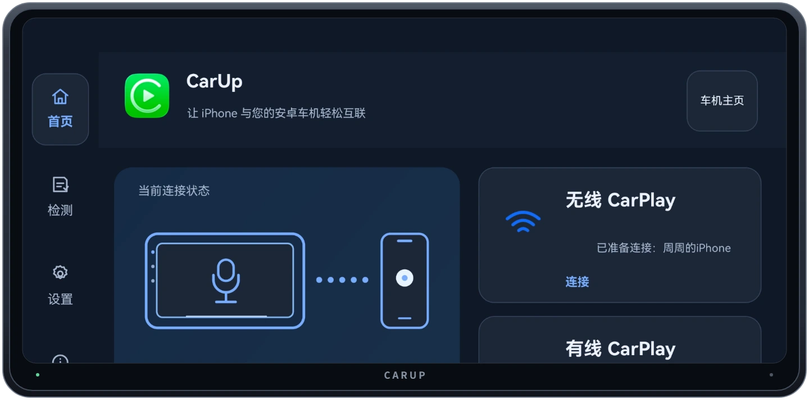
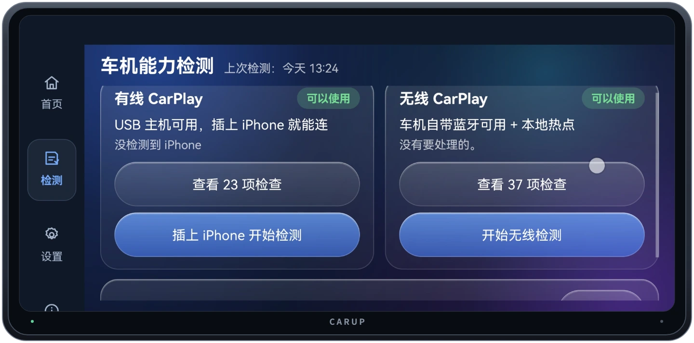
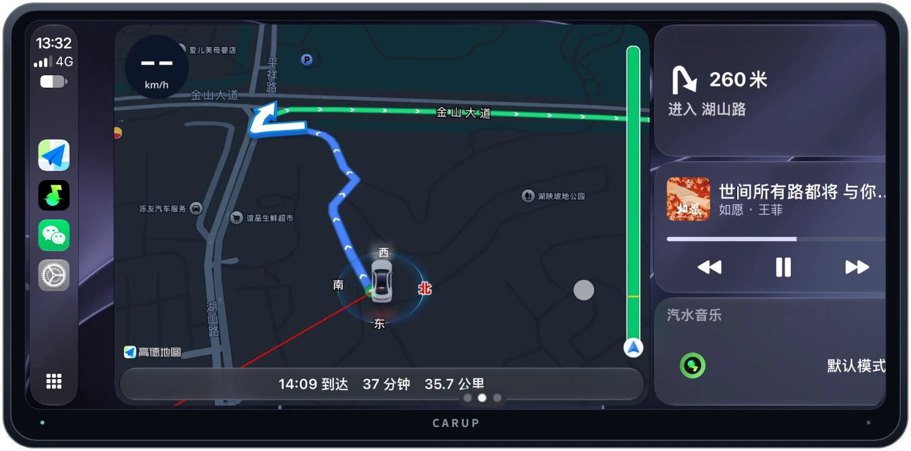
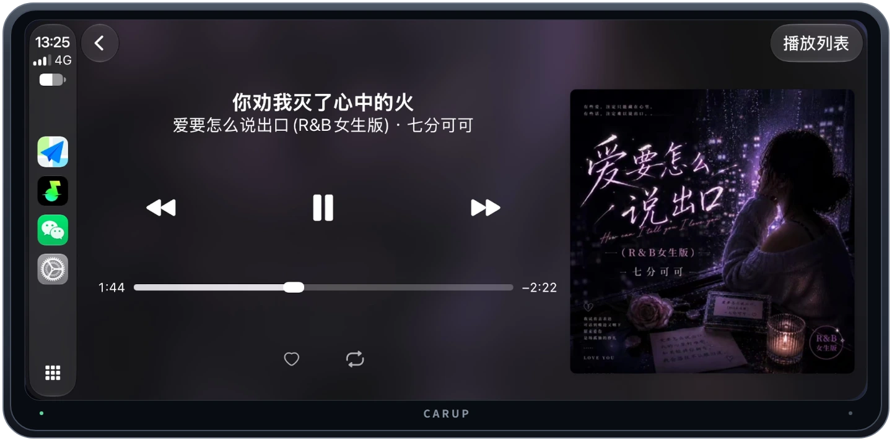
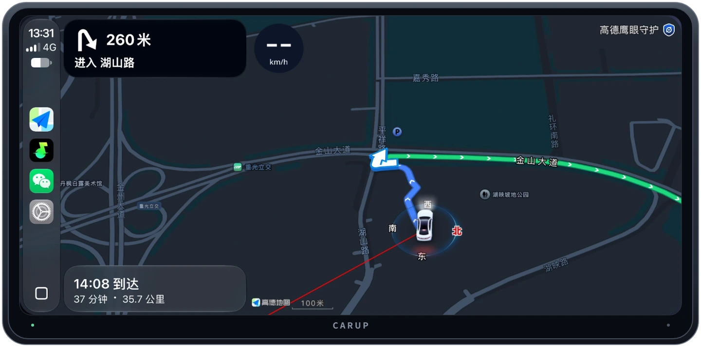

# CarUp

让 iPhone 通过有线或无线 CarPlay 连接安卓车机。

[下载 CarUp 3.0](https://github.com/nobcdz/CarUp/releases) · [查看使用手册](使用手册/README.md)

**APK 来源说明**：本仓库 Releases 提供的 CarUp 3.0 APK 来源于网络，由本仓库整理分享。

## 先检测，再连接

打开 CarUp 的「检测」页，就能看到当前车机可用的连接方式。有线检测包含 **23 项**，无线检测包含 **37 项**。连接卡住时，可以在列表里查看进度停在 USB、蓝牙、Wi‑Fi、认证还是 iPhone 授权。

| 连接方式 | 怎么开始 |
| --- | --- |
| 有线 CarPlay | 确认检测页显示 USB 主机可用，再用支持数据传输的线连接 iPhone。 |
| 无线 CarPlay | 在检测页确认无线条件就绪，从首页发起连接，按 iPhone 提示完成配对和授权。首次配对后可使用无线自动连接。 |

## 连接后的车机体验

在 CarPlay 中可以使用高德地图、汽水音乐等 iPhone 上支持 CarPlay 的应用。导航可以全屏显示，也可以切到仪表板，一边看路线和转向提示，一边控制音乐。

| 音乐播放 | 全屏导航 |
| --- | --- |
|  |  |

CarUp 提供自动画面适配、屏幕方向、音频缓冲、方向盘按键和浅色／深色外观等设置。进入 CarPlay 后，可从屏幕顶部双指下滑打开 CarUp 设置，或长按车机返回键回到 CarUp。

## 下载与安装

1. 打开 [GitHub Releases](https://github.com/nobcdz/CarUp/releases)，在 3.0 版本的附件中下载 `CarUp-3.0-release.apk`。
2. 将 APK 传到安卓车机，按车机提示完成安装。
3. 打开 CarUp，先到「检测」页确认可用的连接方式，再按[使用手册](使用手册/README.md)完成连接。

CarUp 的兼容目标为 **Android 4.0 及以上**。实际可用的连接方式取决于车机的 USB、蓝牙和 Wi‑Fi 能力，以设备上的检测结果为准。
