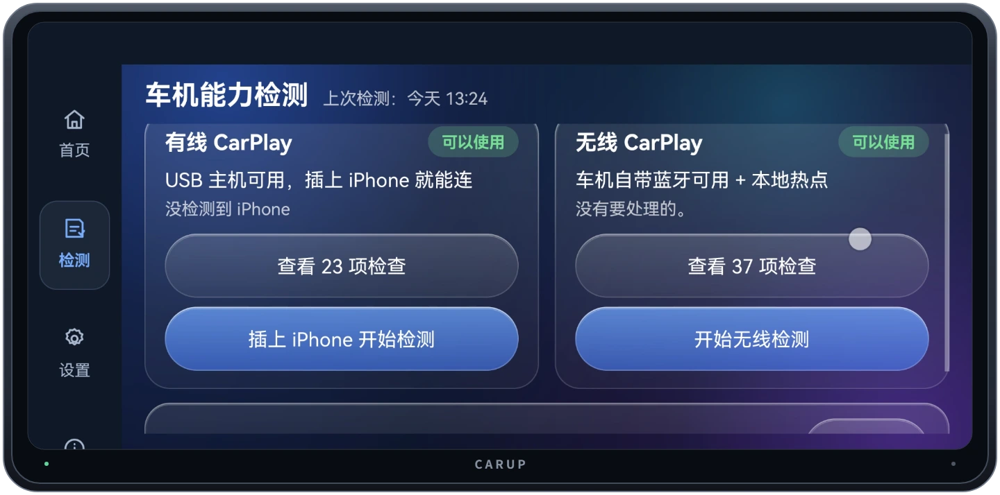
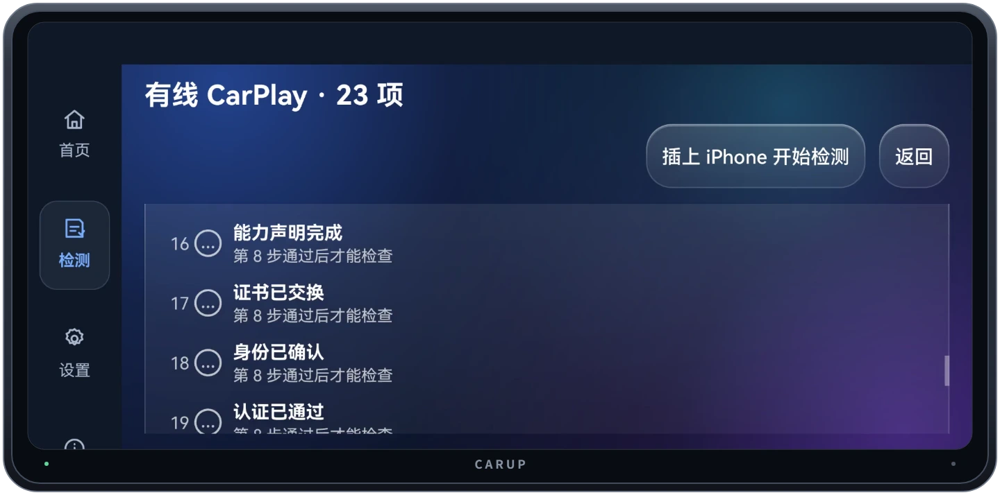
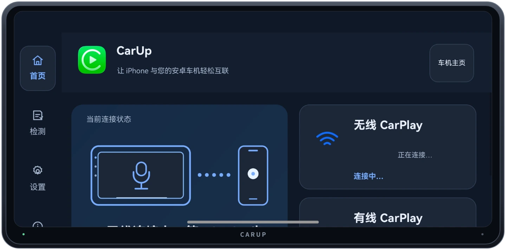
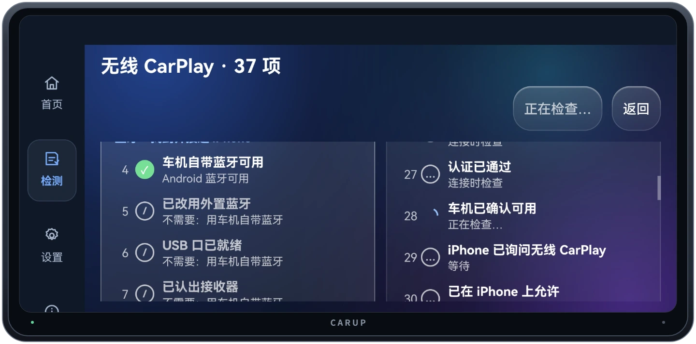
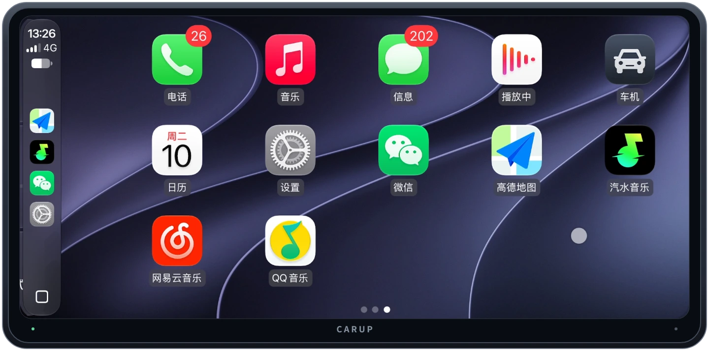
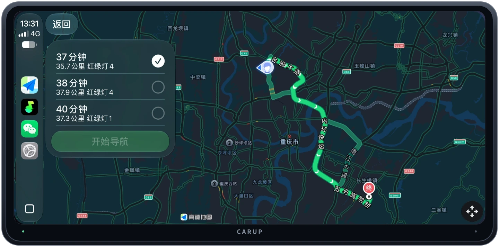
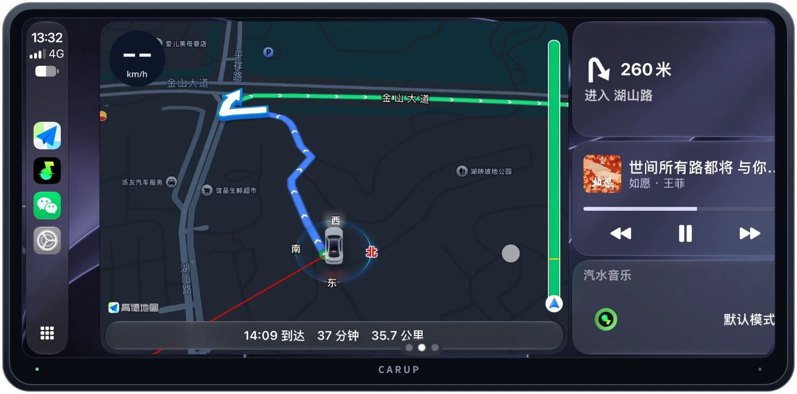
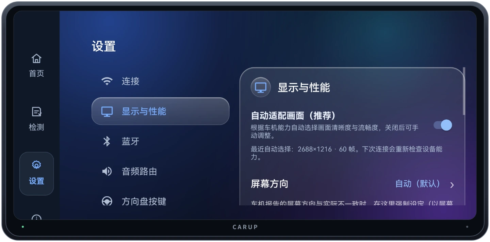
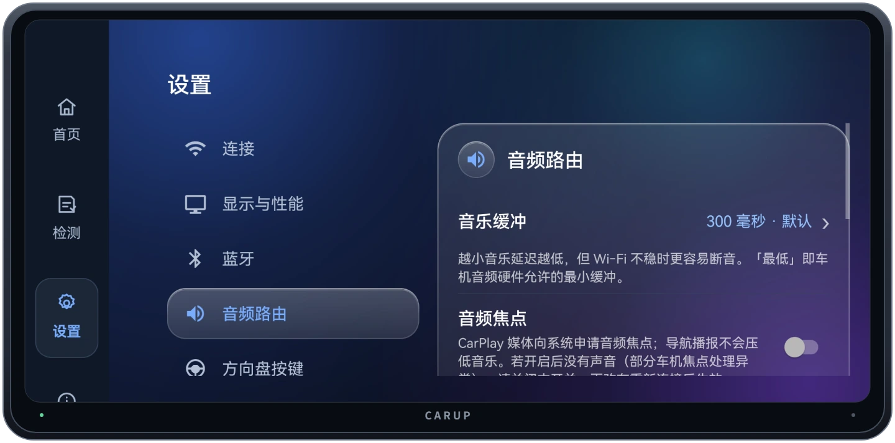

# CarUp 3.0 使用手册

[返回项目首页](../README.md) · [下载 CarUp 3.0](https://github.com/nobcdz/CarUp/releases)

## 1. 安装并检测车机

把 APK 传到安卓车机，在车机上打开并完成安装。如果系统拦截安装，按提示为当前文件管理器或安装来源开启相应权限。安装完成后打开 CarUp，进入左侧「检测」。

- **有线**关注 USB 主机状态。页面显示「没检测到 iPhone」时，可以插入 iPhone 再开始检测。
- **无线**关注蓝牙和 Wi‑Fi 条件。点击「开始无线检测」，可在 37 项列表里查看当前进度。
- 页面下方还有「共用检测」入口，可检查画面、音量键、麦克风等项目。

## 2. 连接 iPhone

### 有线 CarPlay

1. 解锁 iPhone，用支持数据传输的 USB 线将它连到车机。
2. 打开「检测 → 有线 CarPlay」，按提示插入 iPhone 并开始检测。
3. 按手机上的提示完成授权，等待 CarPlay 画面出现。若没有进入，打开 23 项检查，查看进度停在哪一步。

### 无线 CarPlay

1. 打开 iPhone 的蓝牙和 Wi‑Fi，把手机放在车机附近。
2. 在 CarUp 首页找到「无线 CarPlay」，点击「连接」。
3. 首次连接时，按 iPhone 提示完成配对并允许使用 CarPlay，等待画面出现。再次上车时可使用无线自动连接。

若一直停在「正在连接」，回到「检测 → 无线 CarPlay」，查看车机蓝牙、Wi‑Fi、iPhone 授权或入网步骤的状态。列表里的「等待」也可能表示前一步还没完成，可以从前往后找第一处卡住的位置。

## 3. 在 CarPlay 中导航和听歌

连接后，通过左侧栏在应用网格和分屏仪表板间切换。应用网格中显示的应用取决于 iPhone 上可用于 CarPlay 的应用。

以高德地图为例，选好目的地后，先对比路线用时，再点击「开始导航」。进入导航后，可以切换全屏、路线全览和分屏仪表板。

分屏时，左侧显示地图路线，右侧可查看下一步转向和操作音乐。需要回到 CarUp 时，长按车机返回键。需要打开 CarUp 设置时，从屏幕顶部双指下滑。

## 4. 调整车机设置

| 设置项 | 用途 |
| --- | --- |
| 显示与性能 | 「自动适配画面」按车机能力选择清晰度和流畅度。也可检查屏幕方向设置。 |
| 音频路由 | 音乐缓冲默认显示 300 毫秒。缓冲较小时延迟更低，无线网络不稳定时也更容易断音。此处还可调整音频焦点。 |
| 方向盘按键 | 从此入口查看或调整按键设置，并在车上逐键验证。 |
| 外观 | 可选浅色、深色，或随车机系统切换。 |
| 位置 | 可按需开启向 iPhone 报告安卓端位置的选项。 |
| 问题诊断与反馈 | 连接或使用异常时，从此入口查看诊断与反馈选项。 |

| 显示与性能 | 音频路由 |
| --- | --- |
|  |  |

## 5. 常见问题

| 现象 | 先检查什么 |
| --- | --- |
| 插线后检测不到 iPhone | 确认 USB 主机可用，换一条支持数据传输的线，解锁 iPhone 后再插入。 |
| 无线连接一直等待 | 查看 37 项检测中最先卡住的一项，确认 iPhone 蓝牙、Wi‑Fi 已打开，并处理手机上待确认的授权。 |
| 已连上但画面方向不对 | 检查「设置 → 显示与性能 → 屏幕方向」。 |
| 无线播放时偶尔断音 | 检查无线连接状态，并查看「设置 → 音频路由 → 音乐缓冲」是否调得过低。 |
